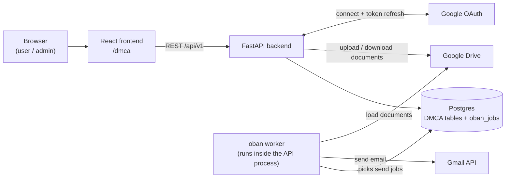
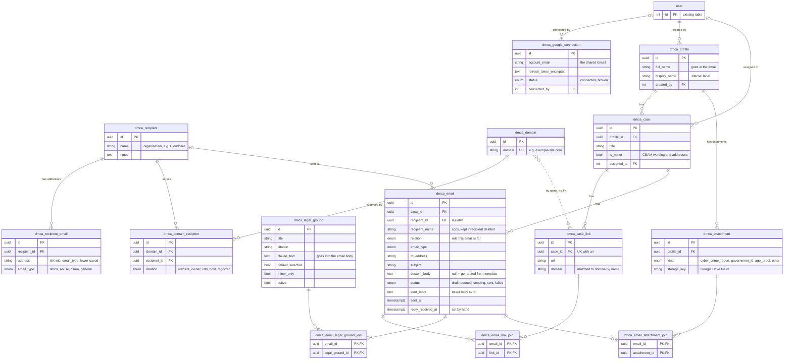

# DMCA bulk takedown emails

## Contents

1. [Summary](#1-summary)
2. [Key concepts](#2-key-concepts)
3. [End-to-end flow](#3-end-to-end-flow)
4. [Database overview](#4-database-overview)
5. [Code structure](#5-code-structure)
6. [Google integration](#6-google-integration)
7. [Sending](#7-sending)
8. [Email template](#8-email-template)
9. [API overview](#9-api-overview)
10. [Setup](#10-setup)
11. [Testing](#11-testing)
12. [Known limits and parked items](#12-known-limits-and-parked-items)
---

## 1. Summary

The DMCA takedown tool lives in the app at `/dmca`.

A user pastes the links where non-consensual content of a victim has been posted. The app then:
- works out which organisations to email about each site: the site's owner, its CDN, its host or its registrar
- creates one takedown email draft per organisation, from a standard template
- lets the user review and edit each draft before anything is sent
- sends the emails in bulk from one shared Gmail account, through a background queue, with the victim's documents attached

After sending, the user can mark which emails got a reply, and escalate to the next organisation in the chain (for example from the site owner to its CDN).

Admins set up everything the users rely on in a Config page: the organisations, their email addresses, the sites, the legal clauses used in the emails, and the connection to the shared Google account.

**Built with:** the backend (FastAPI, Postgres, an oban-py job queue, Gmail and Google Drive) and the frontend (React).

---

## 2. Key concepts

These are the terms used in the rest of this description.

- **Organisation (`dmca_recipient`):** someone we send emails to, for example a site's owner, Cloudflare, a hosting company or a domain registrar.
  - An organisation has one or more email addresses.
  - Each address has a **type**: dmca, abuse, csam or general. The type says what kind of inbox it is, e.g. an abuse desk or a DMCA desk.
- **Site (`dmca_domain`):** a website, identified by its domain name, e.g. `example-site.com`.
  - Every link the user pastes is on some site. For example, the link `https://www.example-site.com/videos/123` is on the site `example-site.com`.
  - Admins add sites in Config, along with the organisations that work for each one (see Role, below).
- **Role (`relation`):** what an organisation does for a site: website owner, CDN, host or registrar.
  - Config records this per site, e.g. "Cloudflare is the CDN for example-site.com". These records live in the `dmca_domain_recipient` table.
  - A site can have a different organisation in each role. For example, example-site.com has its own owner, Cloudflare as its CDN, and some hosting company as its host.
  - One organisation can work for many sites. For example, Cloudflare can be the CDN for both site-a.com and site-b.com.
- **Two separate orders:** the app uses two orders, and they answer two different questions.
  - **Role order** (website owner → CDN → host → registrar) decides **who** to email about a site. The review screen pre-fills the site's first organisation in this order ([flow](#3-end-to-end-flow) step 7), and Escalate moves to the next one (step 11).
  - **Address-type order** decides **which inbox** to use once the organisation is chosen. It is dmca → abuse → general, or csam → dmca → abuse → general on minor cases. It only picks from the types that organisation actually has.
- **Profile and case:**
  - A **profile** is the victim: their name and their documents (ID, cyber crime report, age proof and so on).
  - A **case** belongs to a profile. It holds a set of links being taken down for that person, and the emails sent about them.
  - A case also carries who it's assigned to, and whether the victim is a minor.
- **Minor cases** (`is_minor` on the case): when a case is marked as a minor's,
  - the email subject starts with `CSAM/DMCA`
  - the email body gets an extra paragraph
  - csam addresses are preferred when picking an inbox
  - legal grounds marked "minor only" are offered on its emails

---

## 3. End-to-end flow

### System

- An admin connects one shared Google account, once. Every email is sent from that account's Gmail, and every uploaded document is stored in that account's Google Drive.
- Sending happens in the background. When the user clicks Send, the API marks the emails as queued and adds one job per email to the `oban_jobs` table. A worker running inside the API process picks those jobs up and sends the emails one at a time.

### Step by step

All endpoints below are under `/api/v1`. For example, `POST /dmca/profiles` is really `POST /api/v1/dmca/profiles`.

**Admin setup (once)**

1. **Connect Google:** on the Config page, the admin clicks **Connect** and signs in to the shared Google account through Google's usual consent screen.
   - The backend receives a refresh token from Google and stores it, encrypted, in the database (the `dmca_google_connection` table).
   - From then on the backend uses that token whenever it needs to send an email or touch Drive. The full flow is in [Google integration](#6-google-integration).
2. **Fill in Config:** the admin adds
   - the organisations, and their email addresses. An organisation can have several addresses, each with one type (dmca, abuse, csam or general).
   - the sites, and which organisation plays which role for each one (website owner, CDN, host or registrar)
   - the legal grounds: the legal clauses that can be cited in the emails. Each one can be marked "ticked by default" (added to every new draft) and "minor only" (only offered on minor cases).

**User flow**

3. **Create a profile** for the victim. The frontend sends the details to `POST /dmca/profiles`.
   - `full_name` is the name used in the emails.
   - `display_name` is optional. It's an internal label shown in the app's lists, and never goes in an email.
4. **Upload documents** to the profile: the cyber crime report, an ID, an age proof, or any other document. The frontend sends each file to `POST /dmca/profiles/{id}/attachments`.
   - The backend uploads the file to a folder in the connected account's Google Drive.
   - The database keeps only the file's details (name, type, size, kind) and its Drive file id. The file itself is not stored in the database.
   - Documents belong to the profile, so every case of that person can attach them to its emails.
5. **Create a case** on the profile, with a title and a "minor" tick. The frontend sends it to `POST /dmca/profiles/{id}/cases`.
   - The new-case form assigns the case to the user who creates it. It can be reassigned later on the case page.
6. **Paste links:** the user pastes links into the case, and the frontend sends the text to `POST /dmca/cases/{id}/links {text}`.
   - The backend splits the text into URLs, removes duplicates, and skips any URL that is already in this case.
   - For each URL it works out the domain (lower-cased, with `www.` dropped) and saves the link as a `dmca_case_link` row, with the domain in `dmca_case_link.domain`. The URL itself is stored exactly as pasted.
   - It returns three lists: `added`, `skipped` (already in this case) and `invalid` (not a link).
   - "Skipped" only means the link isn't saved a second time, because the case already has it. It doesn't stop the link being emailed again (see the next step).
   - Each `dmca_case_link` belongs to its case. It is not linked to the `dmca_domain` table: `dmca_case_link.domain` is plain text, and is matched to Config by name in the next step.
7. **Review screen:** this opens in two ways.
   - **Right after pasting.** It shows every link that was just pasted:
     - the ones newly added to the case
     - the ones skipped because the case already had them

     A skipped link isn't added to the case a second time, but it can still be drafted here like any other. So to email a link again (for example, a reminder to the same organisation), the user just pastes it again.
   - **From Draft emails** on the case's links. This only offers the links that haven't been emailed yet.
   - The **frontend** builds the review screen. It groups the links by `dmca_case_link.domain`, so there is one row per site.
   - It sends those domain names to `GET /dmca/domains/resolve?domains=…`.
   - The **backend** looks each name up in the `dmca_domain` table and returns the organisations linked to that site, with their roles and the address types they have. A site that isn't in Config comes back with no organisations, and the user picks one by hand.
   - The frontend then pre-fills each row:
     - **the organisation:** the site's first one in role order (website owner → CDN → host → registrar)
     - **the address type:** dmca → abuse → general (minor cases: csam first), from the types that organisation has
     - **New email**, or **Add to draft** when this case already has a draft to the same organisation and address type
   - Everything on a row can be changed before the drafts are created.
8. **Create drafts:** the user clicks to create the drafts, and the frontend sends every row to `POST /dmca/cases/{id}/drafts`. Each row says "send these links (`link_ids`) to this organisation, with this address type".
   - The backend groups the rows by organisation and address type. Rows that point to the same organisation and the same address type become **one** draft. For example, if Cloudflare is picked as the CDN for both site-a.com and site-b.com, Cloudflare gets one email covering both sites.
   - It picks the To address from the organisation's addresses of the chosen type.
   - It adds the legal grounds marked "ticked by default" (leaving out minor-only ones on non-minor cases).
   - It generates the subject from the sites in the email.
   - A row marked **Add to draft** adds its links to that existing draft instead. If that draft's body had been edited by hand, it's reset to the template so the new links appear in it.
   - Everything is saved in one go. If any row is invalid (for example a link that isn't in this case), nothing is created.
   - The draft doesn't store a body of its own. Each time the email is shown, its body is built from the template, using the draft's current links and legal grounds. A body is only stored if the user edits it by hand (step 9); from then on, that edited text is used instead of the template (see the [Behaviour notes](#behaviour-notes)).
9. **Edit a draft:** the user opens a draft from the case's email list. Changes are sent to `PATCH /dmca/emails/{id}`. The user can change:
   - the To address, picked from the organisation's addresses in Config. The backend checks that the address really is one of them, and updates the email's address type to match.
   - the subject
   - the body. The frontend sends the body only if the user actually typed in it. It's then stored as `custom_body`.
   - which links, legal grounds and documents (attachments) are on the email. Ticks and dropdowns save straight away; the subject and body are saved with **Save changes**.

   Only drafts can be edited. Once an email is queued or sent, the backend refuses changes.
10. **Send:** the user ticks one or more drafts and clicks **Send selected**.
    - A confirm dialog lists the emails. It blocks sending if an email has no To address, and warns (without blocking) if an email has no documents attached.
    - On confirm, the frontend calls `POST /dmca/emails/send`.
    - The backend marks the emails `queued` and adds one oban job per email.
    - The worker sends them one at a time, `SEND_GAP_SECONDS` apart (3 seconds by default).
    - For each email, the backend downloads its documents from Drive and attaches them to the email it sends.
    - Each email ends up `sent`, or `failed` if it still can't be sent after a few retries. A failed email has a **Retry** button.
    - While any email is queued or sending, the frontend re-fetches the list every 3 seconds, so the statuses update on their own.
    - The details are in [Sending](#7-sending).
11. **After sending:**
    - **Got a reply:** a manual tracking of whether a sent email got a reply on the Gmail inbox or not (this app doesn't store or check for replies). When one comes in, the user ticks **Got a reply** on that email, which calls `PUT /dmca/emails/{id}/reply-received`. It can be unticked.
    - **"No reply · 48h+":** a sent email with no reply ticked, sent more than 48 hours ago, shows this badge. It's worked out by the backend each time the email is read, not stored. It's only a signal for the user; nothing happens automatically.
    - **Escalate:** every sent email has an **Escalate** button. It opens the review screen on the email's case page, with the email's links.
      - The frontend asks `GET /dmca/emails/{id}/escalation` who to email next.
      - For each site in the email, the backend finds the role this email was sent to (e.g. website owner), then suggests the site's first organisation in a later role (e.g. its CDN). If there's no later role with an organisation, there's no suggestion for that site.
      - The review screen is pre-filled with those suggestions, and works the same as in step 7. Creating drafts from it makes new drafts; the sent email isn't touched.
12. **Outbox and profile page:** besides the case page, emails are listed in two more places.
    - The **Outbox** lists every email across all cases. It has status tabs, a person filter, and a "From cases assigned to me" tick.
    - Each **profile page** lists all emails from that person's cases.
    - Both use the same email list as the case page, so the same actions are available everywhere: edit, send, retry, Got a reply and Escalate.

### Behaviour notes

- **Config gives suggestions only** (step 7). Every pre-filled organisation, address type and draft choice on the review screen can be changed by the user before the drafts are created.
- **New links don't join existing drafts on their own** (steps 6–8). A draft holds only the links picked for it on the review screen. Links pasted later, even for the same site, show as "not emailed yet", and the user adds them through the review screen, as a new email or with **Add to draft**.
- **A link can be emailed more than once** (steps 6–7 and 11). Nothing stops the same link going to several organisations, or to the same organisation again. There are two ways to do it:
  - paste the link again: it's skipped as a duplicate, but still shows on the review screen, where it can be drafted to anyone
  - Escalate a sent email: this opens the review screen with that email's links
- **The body is generated until edited** (step 9). While `dmca_email.custom_body` is empty (`null`), the body is built from the template every time the email is read, so ticking or unticking a legal ground updates it straight away. Once the user types in the body and saves, their text is kept as it is: ticking or unticking legal grounds no longer changes it, until they click **Reset to template**.
- **A sent email is a frozen record** (step 10). When an email is sent, the exact body, the organisation's name and the To address are saved on the email (`sent_body`, `recipient_name`, `to_address`). Later edits or deletes in Config don't change what the app shows as sent.
- **Documents live only in Drive** (steps 4 and 10). On upload, the file goes to Drive and the database keeps only its details and Drive file id (`storage_key`). On sending, the backend downloads it from Drive to attach it. No file content is stored in the database.
- **Only `www.` is dropped from a link's domain** (step 6). Everything else in the domain is kept, including any other subdomain. So `videos.example-site.com` is a different site from `example-site.com`, and needs its own entry in Config to be matched.
- **Links aren't tied to Config** (steps 6–7). `dmca_case_link` is the table of pasted URLs, and its `domain` column is plain text, not a foreign key. So links can be pasted for sites that aren't in Config yet. The review screen shows those sites with no organisation, and the user picks one by hand.

---

## 4. Database overview

The DMCA feature adds 14 tables. On top of those, the oban-py job queue creates and manages its own tables, including `oban_jobs`, which holds the send jobs.

The 14 tables fall into two halves:

- **Config**, set up by admins: who to email about which site, and the legal text to use. The tables are `dmca_recipient`, `dmca_recipient_email`, `dmca_domain`, `dmca_domain_recipient`, `dmca_legal_ground` and `dmca_google_connection`.
- **Casework**, used by users: who the takedown is for, which links, and which emails were sent. The tables are `dmca_profile`, `dmca_attachment`, `dmca_case`, `dmca_case_link`, `dmca_email` and the email's 3 join tables.

**Migrations added:** `005` to `012`. Migration `011` creates oban's tables, using the SQL that oban itself provides.

Roles and address types are explained in [Key concepts](#2-key-concepts).

### What each table is for

| Table | What it holds |
|---|---|
| `dmca_recipient` | An organisation we email: a site owner, CDN, host or registrar. |
| `dmca_recipient_email` | An organisation's email addresses, each with a type (dmca, abuse, csam or general). The type decides which inbox is used. |
| `dmca_domain` | A site, e.g. `example-site.com`. |
| `dmca_domain_recipient` | Which organisation plays which role for a site, e.g. "Cloudflare is the CDN for example-site.com". |
| `dmca_legal_ground` | The legal clauses that can be cited in the emails. `minor_only` ones are only offered on minor cases. |
| `dmca_google_connection` | The one shared Gmail and Drive account. It holds the encrypted refresh token, and is marked `broken` if Google stops accepting it. |
| `dmca_profile` | The victim: the person the content is about. |
| `dmca_attachment` | A document on a profile (ID, cyber crime report, age proof, or other). The file is in Drive; only its details and Drive file id are stored here. |
| `dmca_case` | A set of links being taken down for one profile. It has the `is_minor` flag and an optional assignee. |
| `dmca_case_link` | One URL pasted into a case. |
| `dmca_email` | One email to one organisation. It's a draft until sent, and after that a record of what went out. |
| `dmca_email_link_join` | Which of the case's links an email covers. |
| `dmca_email_legal_ground_join` | Which legal clauses an email cites. |
| `dmca_email_attachment_join` | Which of the profile's documents an email attaches. |

### Things worth knowing

- **`dmca_case_link.domain` has no foreign key to `dmca_domain`.** This is on purpose, so links can be pasted for sites that aren't in Config yet. A foreign key would have meant either rejecting those links, or creating a `dmca_domain` row automatically for every site ever pasted, which would fill the admins' Config with sites nobody set up. Instead, the review screen matches by name. Once an admin adds the site to Config, it matches automatically.
- **A sent email doesn't depend on Config.** The organisation's name, the To address and the exact body are copied onto the email (`recipient_name`, `to_address`, `sent_body`), so the record stays correct even if Config changes later.
- **Uniqueness rules:**
  - a URL can be in a case only once (`case_id, url`)
  - a site can be in Config only once, ignoring case (`lower(domain)`)
  - an address can be added only once per type, ignoring case (`lower(address), email_type`)
  - an organisation can have a given role for a site only once (`domain_id, recipient_id, relation`)
- **What happens on delete:**
  - Deleting a profile deletes its cases, links, emails and documents along with it. There's no delete button or route for profiles yet, though.
  - Deleting an organisation keeps the emails that were sent to it. Their `recipient_id` is set to empty, and the organisation's name stays on each email.
  - A legal ground or a document that has been used on an email can't be deleted. The database refuses it (`RESTRICT`).
- **"No reply · 48h+" isn't stored.** It's worked out each time from the email's status (`sent`), `sent_at` and `reply_received_at`.
- **`dmca_case_link.removed_at` exists but isn't used yet.** The column was added in case we want to track per-URL removal in future. Drafting already leaves out links that have it set.
- **Left out of the diagram to keep it readable:** most casework tables have a `created_by` or `uploaded_by` column pointing to `user`, and every table has `created_at` and `updated_at`.

---

## 5. Code structure

### Backend (`backend/app/`)

A request goes route → CRUD → model → database. The routes handle HTTP (checking input, permissions and status codes), the CRUD functions hold the database logic, and the models define the tables. Helpers that don't touch the database live in `services/` and `utils/`.

| Where | What's there |
|---|---|
| `models/dmca/` | The tables and the API's request and response shapes, one file per area: `recipient`, `legal_ground`, `profile`, `case`, `attachment`, `takedown_email`, `google_connection`, and `enums` for the shared choices. |
| `crud/dmca/` | The database logic, with the same file names. Functions take keyword-only arguments, and return `None` when something isn't found. |
| `api/routes/dmca/` | The routers. `CurrentUserDep` allows any logged-in user, and `AdminDep` allows admins only. |
| `services/template.py` | Builds the subject and body, and picks the address. It doesn't touch the database, so it's easy to test. |
| `services/google_auth.py` | The Google connection flow, and `get_credentials()`, which gives the rest of the code a working Google login. |
| `services/queue.py`, `sending.py`, `gmail.py`, `google_errors.py` | The send queue, sending one email, building the Gmail message, and sorting Google errors into retry or don't retry. |
| `services/storage/` | The `Storage` interface (`save` and `get`), `DriveStorage` for real use, `MemoryStorage` for tests, and `get_storage()`, which picks one based on the `STORAGE_BACKEND` setting. |
| `core/crypto.py` | Encrypts and decrypts the refresh token (Fernet). |
| `utils/links.py` | Splits pasted text into URLs and works out each URL's domain. |

**Conventions:**
- Each area uses the same file name in every layer, e.g. `models/dmca/case.py`, `crud/dmca/case.py`, `routes/dmca/cases.py` and `tests/test_cases.py`.
- Every DMCA table starts with `dmca_`, so they sort together and can't clash with other features' tables. The Python classes keep short names (`Recipient`, `Case`, …).
- Many-to-many (join) tables end in `_join`, e.g. `dmca_email_link_join`, which pairs emails with links.
- All routes are under `/api/v1`, and can be tried out at `/docs`.

### Frontend (`frontend/src/`)

| Where | What's there |
|---|---|
| `routes/_userLayout/dmca/` | The pages: the profiles list, a profile, new case, a case, the outbox, Config, and the layout with the tabs. |
| `queries/dmca/` | The hooks that call the API, one file per area. Reads are named `xxxQueryOptions` and writes are `useXxx()` mutations. Query keys start with `["dmca", area]`. |
| `dmca/components/` | The pieces the pages are built from: `ReviewDrafts`, `EmailList`, `EmailEditor`, `SendConfirmDialog`, `AddLinksFlow`, `CaseLinks`, `DocumentsPanel`, `RecipientsConfig`, `LegalGroundsConfig`, `GoogleCard`, `GoogleBanner` and a few more. |
| `dmca/types.ts` | The API's shapes as TypeScript types, written by hand in snake_case to match the backend. |
| `dmca/errors.ts` | `toastError`, used as the `onError` of every mutation. It shows the backend's error message (`detail`) as a toast. |
| `dmca/ui.ts`, `dmca/labels.ts` | Shared Tailwind classes, and the display labels for the enums. |

### Where to start reading

For someone new to this code, this order goes from the data, to the core decisions, to the edges.

1. **The tables:** start with `backend/app/models/dmca/`. Each file holds one area's tables, plus the shapes the API accepts and returns for them (`Create`, `Update` and `Public` classes).
2. **The core logic:** most of the interesting decisions are in three files.
   - `crud/dmca/takedown_email.py`:
     - `create_drafts` turns the review screen's rows into drafts
     - `update_takedown_email` edits a draft
     - `suggest_escalation` works out who to email next
     - `no_reply_48h` decides the "No reply · 48h+" badge
   - `services/template.py`: builds the subject and body, and `pick_address` picks the To address
   - `utils/links.py`: `parse_links` and `extract_domain`, which split pasted text into links and work out each link's site
3. **The routes:** `backend/app/api/routes/dmca/`. They are kept thin: each one checks the request, calls a CRUD function, and turns "not found" into a 404 and duplicates into a 409.
4. **Sending:**
   - `services/queue.py`: the oban worker, and `enqueue_sends`, which adds the jobs
   - `services/sending.py`: `send_email`, which sends one email and records the result
   - `services/gmail.py`: builds the email message, and swaps the recipient outside production (see [Sending](#7-sending))
   - `services/google_errors.py`: decides which Google errors are worth retrying
5. **Google and file storage:**
   - `services/google_auth.py`: the Google connection flow, and getting fresh access tokens
   - `core/crypto.py`: encrypting and decrypting the stored refresh token
   - `services/storage/`: a small `Storage` interface, with a Google Drive version for real use and an in-memory version for tests
6. **Frontend:**
   - `frontend/src/queries/dmca/`: the hooks that call the API
   - `frontend/src/dmca/components/`: the main screens' pieces. `ReviewDrafts.tsx`, `EmailList.tsx` and `EmailEditor.tsx` are the most important.
   - `frontend/src/routes/_userLayout/dmca/`: the pages

### Where DMCA plugs into the rest of the app

Most DMCA code lives in its own `dmca` folders. These are the few places outside them that it touches:
- `core/config.py`: the DMCA settings, and a startup check that refuses to run outside production unless `EMAIL_REDIRECT_TO` is set
- `main.py`: starts the queue when the app starts, and stops it when the app stops (`lifespan`)
- `api/main.py`: registers the DMCA routers
- `alembic/env.py`: makes Alembic's autogenerate ignore oban's tables
- `models/__init__.py`: imports the DMCA tables, so Alembic and the tests can see them
- `pyproject.toml` and `uv.lock`: the DMCA dependencies
- `.env.test`: fake values for the DMCA settings, used by the tests
- frontend: `main.tsx` (adds the toast messages), `_userLayout.tsx` (adds the DMCA link to the navigation) and `routeTree.gen.ts` (generated by the router)

---

## 6. Google integration

The app uses one shared Google account for two things: sending emails through its Gmail, and storing documents in its Google Drive.

- **Permissions asked for (scopes):** `gmail.send` to send emails, and `drive.file` to store documents. It also asks for `openid` and `userinfo.email`, only to read the account's email address. `drive.file` lets the app see only the files it created itself, not the rest of the account's Drive.
- **Libraries:**
  - `google-auth-oauthlib`: its `Flow` class runs the sign-in. It builds Google's sign-in URL, and exchanges the code Google sends back for tokens.
  - `google-auth`: its `Credentials` class holds the refresh token, and gets fresh access tokens from Google with it.
  - `google-api-python-client`: `build("gmail", ...)` and `build("drive", ...)` create the clients that make the actual Gmail and Drive API calls, using those `Credentials`.
  - `PyJWT` (already used for login tokens) signs and checks the `state` token, and `cryptography` (Fernet) encrypts the stored refresh token.
- **Table:** `dmca_google_connection`. It has at most one row: the account's email, the encrypted refresh token, the scopes that were granted, and a status of `connected` or `broken`.
- **Files:**
  - `models/dmca/google_connection.py`
  - `crud/dmca/google_connection.py`
  - `services/google_auth.py`
  - `api/routes/dmca/google.py`
  - `core/crypto.py`

### Connection flow

1. The admin clicks **Connect** on the Config page. The frontend calls `GET /google/connect`, with the admin's login token as usual.
2. The backend prepares Google's sign-in:
   - It creates a `Flow` (from `google-auth-oauthlib`) with the app's OAuth client id and secret, the scopes, and the redirect URI.
   - It creates the `state` token. This is a small JWT holding the admin's user id and an expiry 10 minutes ahead, signed with the app's `SECRET_KEY` (HS256, the same way login tokens are signed).
   - It calls `flow.authorization_url(...)` with that `state`. This returns Google's sign-in URL, and asks for offline access with a consent prompt, so Google always returns a refresh token, even on a reconnect.
   - It returns the URL to the frontend.
3. The frontend sends the browser to that URL. This is the "Sign in with Google" page that we see every time we sign in with Google.
4. The admin signs in to the shared Google account and allows access to Gmail and Drive.
5. Google sends the browser back to the **backend**, at `/google/callback?code=…&state=…`. This URL has `code` and `state` in the params.
6. The backend handles the callback:
   - This request comes from Google's redirect, so it has no login header. Instead, the backend verifies the `state` token: it checks the signature with `SECRET_KEY` and checks that the token hasn't expired. If both are fine, it reads the admin's user id from it, and checks that this user is still an active admin. If anything fails, the connection is refused, and the user is sent back with "The link expired, try again".
   - It builds the same `Flow` again and calls `flow.fetch_token(code=…)`. The library sends the `code`, together with the client id and secret, to Google's token endpoint. Google replies with a short-lived access token, the **refresh token**, and an ID token that carries the account's email address.
   - It checks that both Gmail and Drive access were granted (the admin can untick them on Google's screen), and reads the account's email from the ID token.
   - It saves the connection: the account's email, the refresh token (encrypted) and who connected it.
7. The backend then sends the browser to the frontend's Config page, at `/dmca/config?google=connected`, or `?google=error&reason=…` if something went wrong.
8. The Config page reads those URL params, which were set by **our backend**, not by Google. It shows a success or error toast, refreshes the Google status, and cleans the params out of the URL.

**After that:** whenever an email is sent or a document is uploaded or downloaded, `get_credentials()` decrypts the refresh token, puts it in a `Credentials` object (from `google-auth`) and calls `creds.refresh(...)`, which asks Google for a fresh access token. Those `Credentials` are then used for the Gmail or Drive call. If Google refuses (for example because someone removed the app's access in the Google account), the connection is marked **broken**. The app then shows a red banner, and the Google card on the Config page shows **Reconnect**.

### Other details

- `GET /google/status` tells the frontend whether Google is connected (any logged-in user can call it). `DELETE /google` disconnects it (admins only).
- The Google OAuth client must be of type **Web application**, and its redirect URI must match the `GOOGLE_REDIRECT_URI` setting exactly.
- **How long the connection lasts** (from [Google's OAuth docs](https://developers.google.com/identity/protocols/oauth2), "Refresh token expiration"):
  - Google expires refresh tokens after 7 days for apps with the *External* user type in *Testing* status. For such an app, the admin would have to reconnect every week. The rule doesn't apply to *Internal* (Workspace) apps or to published apps.
  - Apart from that, a refresh token has no fixed expiry. Google lists the cases where it stops working, e.g. the access was removed, it wasn't used for six months, the account's password was changed (because the token includes a Gmail scope), or a Workspace admin restricted Gmail or Drive for the app.
  - In any of these cases, `get_credentials()` marks the connection broken and an admin reconnects.
- **Drive:**
  - Every document goes into one Drive folder (named by `DRIVE_FOLDER_NAME`), which is created the first time a document is uploaded.
  - Each file can be at most 18 MB (`MAX_ATTACHMENT_MB`), and an email's documents together can be at most 18 MB too. Gmail's own limit is 25 MB, but it counts the size after encoding, which adds about a third.
  - Documents can't be deleted yet.
- **Errors:** uploading or downloading a document returns 409 if Google isn't connected, and 502, with Google's message, if Drive itself fails.

---

## 7. Sending

When the user clicks Send (or Retry), the emails aren't sent during that request. They're put on a background queue (oban-py, which stores its jobs in Postgres). A worker that runs inside the API process takes the jobs one at a time and sends each email through Gmail.

**An email's status goes:** `draft → queued → sending → sent`, or `failed` at the end if it couldn't be sent.

| Status change | What causes it | Where in the code |
|---|---|---|
| draft → queued | the user clicks Send | the send route, via `mark_queued` |
| failed (or stuck in sending) → queued | the user clicks Retry | the retry route, via `mark_queued` |
| queued → sending | the worker picks up the job, just before calling Gmail | `send_email` |
| sending → sent | Gmail accepted the email | `send_email` |
| sending → queued | a temporary error, with tries left | `send_email` |
| sending → failed | a permanent error, or a temporary one on the last try | `send_email` |

### Step by step

1. **Send:** the frontend calls `POST /dmca/emails/send {"email_ids": [...]}`. It's all or nothing: the backend runs every check first, and if any email fails a check, none of them are queued.
   - an id that doesn't exist → 404
   - an email that isn't a draft → 409
   - an email with no To address → 400
   - Google isn't connected, or the connection is broken → 409
2. **Queue:** the backend marks the emails `queued` and saves that to the database, then adds one oban job per email.
   - The status is saved first, so the worker can never pick up a job for an email that's still marked as a draft.
   - If adding the jobs fails, the emails are put back to their previous status and the route returns 503.
3. **The worker** takes one job at a time, and waits `SEND_GAP_SECONDS` between sends (3 seconds by default, so about 20 emails a minute). `send_email` is ordinary blocking code, so the worker runs it in a separate thread, and the API keeps answering other requests in the meantime.
4. **`send_email`** sends one email:
   - First it marks the email `sending` and saves that, **before** calling Gmail.
   - It builds the body, downloads the email's documents from Drive, and sends the email through the Gmail API. The email is sent as an upload, which allows messages up to 35 MB.
   - **If Gmail accepts it:** the email is marked `sent`, with `sent_at`, Gmail's message id, the email's `Message-ID` header, and `sent_body` (a frozen copy of the exact body that was sent).
   - **If it fails:** a short, readable error is saved in `last_error`, so the user can see what went wrong.
     - If the error is temporary and there are tries left, the email goes back to `queued`, and oban tries again after 1 minute, then 5 minutes, then 15 minutes (4 tries in total).
     - Otherwise, the email is marked `failed`.
5. **Retry:** on a failed email, the user can click Retry, which calls `POST /dmca/emails/{id}/retry`. This adds a **new** job, which gets 4 fresh tries.

### Error handling

- **Temporary or permanent?** `google_errors.py` decides:
  - Temporary (worth retrying): HTTP 429 and 5xx errors, a 403 whose reason is a rate limit, and network errors.
  - Permanent (not worth retrying): everything else, for example a bad address, or Google being disconnected.
  - Getting this wrong is safe either way. If a temporary error is treated as permanent, the email is marked failed and the user clicks Retry. If a permanent error is treated as temporary, it's retried 3 times for nothing and then marked failed. Neither case sends the email twice.
- **If the app crashes:**
  - If the app stops in the middle of a send, oban puts the job back on the queue after about 5 minutes.
  - If the crash happens after Gmail accepted the email but before `sent` was saved, the email is sent twice. This is an accepted risk: it's rare, and a duplicate takedown email does no harm.
  - An email that has been stuck in `sending` for more than 10 minutes gets a Retry button, so the user can send it again by hand (`can_retry`).
    - **Why:** say the app crashes during the email's 4th (last) try. oban rescues the job, but it has no tries left, so oban gives up on it instead of running it again. Nothing ever marks the email `failed`, and Retry normally only shows on failed emails, so without this the email would stay in `sending` forever.
    - **Why 10 minutes:** a real send takes seconds, and oban's rescue takes about 5 minutes. So the button never shows on an email that's actually being sent, or is about to be rescued.

### Never emailing real recipients outside production

While developing or testing, the app must never email a real organisation. There are two safeguards:
- `config.py` refuses to start the app if `ENVIRONMENT` isn't `production` and `EMAIL_REDIRECT_TO` is empty.
- `gmail.redirected()` sits on the only path to Gmail's send. Outside production, it replaces the To address with `EMAIL_REDIRECT_TO`, and adds `[TEST → real@address]` to the start of the subject, so the tester can see who it would have gone to.

The database always keeps the real `to_address`.

### Other notes

- The queue runs inside each API process. If the API runs with `--workers 2`, there are 2 queues, so up to 2 emails can be sent at the same time.
- oban deletes finished jobs after a day. The email's own row is the lasting record of what was sent.
- **Two try counters:**
  - oban's `job.attempt` counts the tries of **one job** (1 to 4), and decides when to give up. A Retry creates a new job, so its count starts again at 1.
  - The email's own `attempts` column counts **every** try, across all jobs. For example, 4 tries and then a Retry with 2 more makes `attempts = 6`. No logic depends on it: it's in the API response for debugging, and the UI doesn't show it yet.

---

## 8. Email template

There is one standard template for every email. It lives in `services/template.py`, as plain functions that don't touch the database.

- **Subject:** `DMCA Takedown Request – a.com, b.com, c.com +2 more`. It lists the first 3 sites in the email, then "+N more" for the rest. On minor cases it starts with `CSAM/DMCA` instead.
- **What fills the body:**
  - the profile's `full_name`, used throughout
  - the sites, in the opening line
  - the links: a plain list when the email covers one site, or grouped under each site's name when it covers several
  - the organisation's name, e.g. "This incident breaches *X*'s copyright infringement policy…"
  - the ticked legal grounds, each as `- citation: clause text`
- **Minor cases** get one extra paragraph, which cites POCSO and the IT Act, and states that the age proof has been verified and is attached.
- **What's not in the body:**
  - The address type (dmca, abuse or general) only decides which inbox the email goes to. The text is the same for every type.
  - The attachments are real files attached to the email. They're listed in the app's UI, not written into the email's text.
- **Edited by hand:** when the user types in the body and saves, the text is stored as `custom_body` and used as it is, until they click **Reset to template**. If the saved text is the same as the generated one (ignoring spaces at the start and end), it's not treated as an edit, and `custom_body` stays empty.
- **`pick_address`** picks the To address for a new draft. If the user chose an address type on the review screen, that type is used. Otherwise the address-type order is used.

---

## 9. API overview

Everything is under `/api/v1`. Any logged-in user can read everything and do the casework. Changing Config and connecting Google need an admin.

| Area | Endpoints | Who |
|---|---|---|
| Organisations | `GET/POST /dmca/recipients`, `GET/PATCH/DELETE /dmca/recipients/{id}`, `POST/DELETE …/{id}/emails`, `POST/DELETE …/{id}/domains` | reads: any user; changes: admin |
| Site lookup | `GET /dmca/domains/resolve?domains=a.com,b.com` | any user |
| Legal grounds | `GET/POST /dmca/legal-grounds`, `PATCH/DELETE /dmca/legal-grounds/{id}` | reads: any user; changes: admin |
| Profiles | `GET/POST /dmca/profiles` (`?q=` to search), `GET/PATCH /dmca/profiles/{id}`, `POST /dmca/profiles/{id}/cases` | any user |
| Documents | `GET/POST /dmca/profiles/{id}/attachments`, `GET /dmca/attachments/{id}/file` | any user |
| Cases and links | `GET /dmca/cases` (`?assigned_to_me=`, `?profile_id=`), `GET/PATCH /dmca/cases/{id}`, `POST /dmca/cases/{id}/links`, `DELETE /dmca/cases/{id}/links/{link_id}`, `GET /dmca/assignees` | any user |
| Drafts | `POST /dmca/cases/{id}/drafts`, `GET /dmca/emails` (with filters), `GET/PATCH/DELETE /dmca/emails/{id}` | any user |
| Sending | `POST /dmca/emails/send`, `POST /dmca/emails/{id}/retry` | any user |
| After sending | `PUT /dmca/emails/{id}/reply-received`, `GET /dmca/emails/{id}/escalation` | any user |
| Google | `GET /google/connect`, `GET /google/callback`, `DELETE /google` | admin |
| | `GET /google/status` | any user |

**What the error codes mean:**
- 404: not found
- 409: a duplicate, or the item is in the wrong state for this action (e.g. editing an email that's already sent)
- 400: bad input
- 502: a call to Google failed
- 503: the send queue isn't available

---

## 10. Setup

**Python 3.12 or newer** is required (`requires-python = ">=3.12"`), because oban-py needs it. Locally, `uv sync` takes care of this.

**Dependencies added for DMCA:** `google-api-python-client`, `google-auth`, `google-auth-oauthlib`, `cryptography` and `oban`.

**Migrations:** run `alembic upgrade head` to apply `005` to `012`.

**Environment variables:**

| Variable | Required? | What it's for |
|---|---|---|
| `GOOGLE_CLIENT_ID` | yes | The Google OAuth client's id (a Web application client). |
| `GOOGLE_CLIENT_SECRET` | yes | The Google OAuth client's secret. |
| `GOOGLE_REDIRECT_URI` | yes | Where Google sends the browser back to: the backend's callback, e.g. `http://localhost:8000/api/v1/google/callback`. It must match the OAuth client's setting exactly. |
| `TOKEN_ENCRYPTION_KEY` | yes | The key used to encrypt the refresh token (a Fernet key). Generate one with `uv run python -c "from cryptography.fernet import Fernet; print(Fernet.generate_key().decode())"` |
| `EMAIL_REDIRECT_TO` | yes, outside production | Outside production, every email goes to this address instead of the real one. The app won't start without it outside production. |
| `FRONTEND_HOST` | no (default `http://localhost:5173`) | Where the browser is sent after connecting Google. |
| `STORAGE_BACKEND` | no (default `drive`) | Where documents are stored: `drive`, or `memory` for tests. |
| `DRIVE_FOLDER_NAME` | no | The name of the Drive folder for documents. |
| `SEND_GAP_SECONDS` | no (default `3`) | The pause between two sends. |
| `QUEUE_ENABLED` | no (default `true`) | Turns the send queue on or off. It's off in tests. |

Also, `SECRET_KEY` should be **at least 32 bytes** long in production.

**Google Cloud project (one-time):**
1. Enable the **Gmail API** and the **Google Drive API**.
2. Set up the OAuth consent screen, with the scopes `gmail.send` and `drive.file`.
3. Create an OAuth client of type **Web application**, and add `GOOGLE_REDIRECT_URI` as an authorised redirect URI.
4. Put the client id and secret in `.env`.

**Running it locally:**
1. Start Postgres, run the migrations, and start the backend and the frontend as usual.
2. Log in as an admin and open `/dmca/config`.
3. Connect Google, and add some organisations, sites and legal grounds.

---

## 11. Testing

**Backend:** run `cd backend && uv run pytest`. The tests use an in-memory SQLite database, with the queue turned off and Google faked, so nothing ever reaches Google.
- The DMCA tests (11 files) cover:
  - Config CRUD, and that only admins can change it
  - profiles, cases and link parsing
  - creating and editing drafts
  - the template
  - sending, retries, and sorting errors into temporary and permanent
  - escalation
  - the Google connection flow
  - attachments
- SQLite doesn't enforce foreign keys, so the important checks are also done in the code itself, not only by the database.

**Frontend:** there are no automated tests. Every screen was tested by hand, end to end, against the local backend, including real sends through Gmail (redirected to the developer's own inbox).

**To test it by hand:**
1. Fill in Config: for example an organisation with a dmca and an abuse address, linked to a site as its website owner, and a second organisation as that site's CDN.
2. Create a profile, upload a document to it, and create a case.
3. Paste some links on that site, plus one link on a site that isn't in Config.
4. Check what the review screen pre-fills, create the drafts, edit one, and send them.
5. Check the redirect inbox, then try **Got a reply** and **Escalate** on a sent email.

---

## 12. Known limits and parked items

**Limits:**
- **The To address is always one of the organisation's addresses.** On a draft, the frontend only lets the user pick from the addresses saved for that organisation in Config. Typing a free address isn't offered, on purpose:
  - The email stays linked to its organisation (`recipient_id`). With a typed address, an email could say it went to Cloudflare while the To address is something else entirely. The email's history, and what the UI shows about it, would then be wrong.
  - A custom To address is a feature of its own, with its own edge cases to think through (how it's shown, how it relates to the organisation, escalation). It can be added later if needed.
  - The backend enforces it too: `PATCH /dmca/emails/{id}` refuses (400) a `to_address` that isn't one of the organisation's saved addresses, or any address change once the organisation has been deleted.
- **No paging in the UI.** The profiles list shows only the newest 100 profiles (search still finds older ones), and the outbox loads every email at once.
- **No frontend tests.**
- **Documents and profiles can't be deleted.**
- **URLs are stored exactly as pasted,** so `x.com/a` and `https://www.x.com/a/` count as two different links. This is mostly harmless: links only belong to a case and its emails, so the worst case is the same link appearing twice in a case or an email. Normalising them is a to-do.

**Parked decisions:**
- Give each profile its own folder in Drive.
- Block file types that Gmail refuses to send (e.g. `.exe`) at upload time.
- Revisit "generated until edited" if users find it painful to add legal grounds after editing a body by hand.

